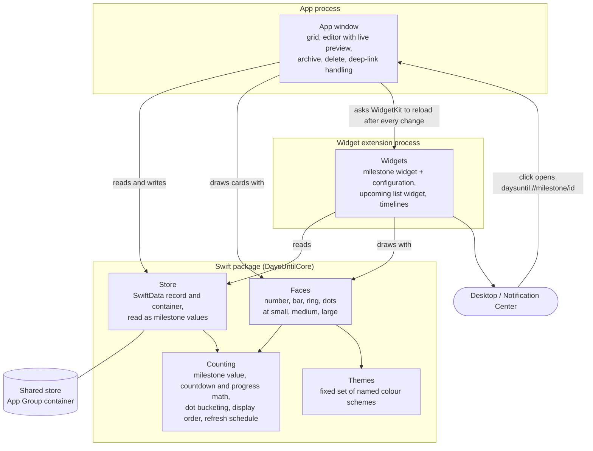

# High-Level Design: DaysUntil

## Problem

Dates that matter to one person (a trip, a deadline, an anniversary, the day a habit
started) live in a calendar, where they are only seen when the calendar is opened. A
calendar also answers "when is it?" rather than the question actually being asked:
"how long until it?" or "how long has it been?", and "how far through the wait am I?".

The Mac desktop is visible all day and supports widgets, but nothing built in puts a
chosen set of personal milestones there as a running count.

## Approach

DaysUntil is a native macOS app that holds a small set of **milestones** and draws each
one as a **face**: a compact, typographic rendering of how far away the milestone is and,
when it has a start, how much of the wait has elapsed.

- **The desktop widget is the product.** The app window exists to create and edit
  milestones; the widgets are where they are read. Every milestone can be placed on the
  desktop as a widget, and each placed widget chooses its own milestone and style.
- **Direction is derived, not chosen.** A milestone has one target date. While that date
  is ahead it counts down ("days until"); once it has passed it counts up ("days since").
  The same object covers a deadline and an anniversary.
- **Counting follows how people talk about dates.** An all-day milestone is counted in
  calendar days, so tomorrow is "1 day" at any hour today. A milestone with a time counts
  to the minute once it is under a day away.
- **Everything is local.** Milestones are stored on the Mac. The app makes no network
  connections and has no account.

## Target Users

- **The owner.** The person who maintains this repository, builds the app and installs
  it. They want milestones in view without opening anything, will set a milestone up once
  and then only glance at it, and care that the widgets look good on their desktop. They
  do not want an Apple developer subscription, a sync service or any recurring upkeep to
  be a condition of the app working.
- **People close to the owner.** A spouse or family member with their own Mac who wants
  the same thing for their own milestones. They do not build software: the owner installs
  the app on their Mac, and from then on it has to work without the owner, without
  Xcode, and without explanation. Each person's milestones are their own and stay on
  their own Mac.

This is a handful of people the owner knows, not a public audience.

## Goals

- A milestone added in the app can be on the desktop as a widget within a minute, with
  no setup beyond choosing it in the widget's edit menu.
- A widget's count is correct at a glance at any time of day, including across midnight,
  daylight-saving changes and leap days, without the app being open.
- A widget always shows something meaningful: a milestone, or a short instruction when it
  has none to show.
- What the app previews is what the desktop shows: a milestone looks the same in the
  editor preview, the app's grid and the widget.
- The app builds, installs and keeps running using only a local Apple Development signing
  certificate.
- Someone who has never seen the app can add their first milestone and put it on their
  desktop using only what the app itself tells them.
- A build made by the owner runs on another person's Mac after the owner installs it
  there, with no developer tools on that Mac.

## Non-Goals

- **Sync, sharing or multi-device.** No iCloud, no account, no server. Two people using
  the app each have separate milestones; there is no shared or family list.
- **Other Apple platforms.** macOS only. Shared logic and views are kept free of
  macOS-only APIs so an iPhone or iPad target stays cheap to add, but none exists.
- **Reminders.** No notifications, alarms or calendar integration; DaysUntil shows, it
  does not interrupt.
- **Public distribution.** No App Store listing and no download that a stranger could
  install. The app reaches another Mac by the owner putting it there.
- **Open-ended customization.** No photo backgrounds, free colour pickers or custom
  fonts; looks come from a fixed set of themes and styles.
- **Localization.** English only.

## Tenets

Ordered; when two conflict, the higher one wins.

- **Glanceable over informative.** When a face could carry one more fact, leave it off
  unless the face is large enough that the main count stays dominant.
- **Calendar meaning over clock precision.** When a count could be exact or could match
  how a person would say it, prefer how they would say it.
- **Local and self-contained over capable.** When a feature would need the network, an
  account, or an entitlement that requires Apple provisioning, leave the feature out
  rather than take the dependency.
- **Opinionated over configurable.** When a look or behaviour could be a setting, pick a
  good default and add a curated option before adding a free-form one.

## System Design

Two processes share one data store. The app is the only writer; the widget extension
only reads. Model, date math and face rendering live in a local Swift package that both
link, so neither process has its own copy of the rules.

Components, each owned by one low-level design under `docs/intent/`:

| Component | Owns |
|---|---|
| **Counting** | The `Milestone` value; how far away a milestone is and in which direction; progress between start and target; the words a count is shown with; bucketing a span into dots; display order; when a displayed count next changes. Pure logic with no UI or storage imports. |
| **Themes** | The fixed list of themes, their colours, and the contrast each must meet. |
| **Store** | The persisted form of a milestone, where the store file lives, and reading milestones out as values. |
| **Faces** | Drawing a milestone in a style at a size, including the fallback when a style cannot apply and the colours used when the system tints or dims a widget. |
| **Widgets** | The two widget kinds, the per-widget choice of milestone and style, timelines, and what a widget shows when it has no milestone. |
| **App window** | Creating, editing, duplicating, archiving and deleting milestones; the grid; the editor and its preview; opening a milestone from a widget click. |

Boundaries that matter:

- Faces and Widgets work on the `Milestone` value, never on the persisted record. Only
  Store and the App window's write path touch the record.
- Counting takes "now" and the calendar as inputs. Nothing in it reads the system clock
  or the current calendar on its own, which is what makes it testable with fixed dates.
- The widget extension never writes to the store.

## Key Design Decisions

| Decision | Alternatives considered | Why this direction |
|---|---|---|
| **One target date; countdown or count-up is derived from whether it has passed.** | A stored direction per milestone; separate "countdown" and "since" object types. | A countdown that passes its date should become "days since" by itself, with nothing to edit. One type also keeps the editor to a single date field. |
| **All-day milestones count calendar days from start-of-day, not 24-hour blocks.** | Elapsed seconds divided by 86,400. | Dividing seconds makes "tomorrow" read 0 days in the evening and drifts by one across daylight-saving changes. Calendar days match how the dates are spoken about. |
| **Progress runs from an optional start date, falling back to the day the milestone was added.** | Requiring a start date; no progress without one. | Most countdowns are added when the wait begins, so the fallback gives a sensible bar with no extra input, while an explicit start covers waits that began earlier. A milestone whose start is not before its target has no progress at all, and progress styles fall back to the number. |
| **App and widgets share one SwiftData store in an App Group container; the app writes, the extension reads.** | The app exporting a JSON snapshot for widgets; each widget storing its own copy in its configuration. | One store means a widget can never disagree with the app about a milestone, and widget configuration stores only a milestone id. Restricting the extension to reads removes any question of two writers. |
| **Faces are one set of views used by both the app and the widgets.** | Separate widget views and app card views. | The editor preview and the grid are promises about what the desktop will show; sharing the views makes the promise structural rather than something to keep in sync by hand. |
| **Widget timelines hold one entry per upcoming change (each midnight, plus a timed milestone's target instant); the app reloads timelines after every write.** | Refreshing on a fixed interval; relying only on app-triggered reloads. | The count changes at known instants, so entries at those instants are exact and cost nothing in between. App-triggered reloads cover edits; scheduled entries cover the app not running. A timed milestone's final day uses a system-driven timer so it ticks without timeline entries. |
| **A fixed set of themes, each carrying its own background, text and accent colours and each required to meet contrast minimums.** | A free colour picker; themes that adapt to light and dark mode. | Curated themes guarantee every face is legible and keep the editor to one row of swatches. A widget carries its own background, so following the system appearance would only make a chosen colour change unexpectedly. |
| **Signing is manual with the local Apple Development certificate and no provisioning profile; the App Group uses the team-ID-prefixed identifier form.** | Xcode automatic signing; ad-hoc signing; a `group.`-prefixed App Group. | A provisioning profile is what expires after seven days on a free account and what makes Xcode contact Apple at build time. The sandbox and a team-ID-prefixed group need no profile on macOS, so this is the only combination that gives a stable identity for widgets and App Group access with nothing to renew. Ad-hoc signatures change every build, which breaks both. The cost is on other people's Macs: a build without Developer ID and notarization is not trusted by Gatekeeper, so the owner installs it by hand and approves it once. Developer ID would remove that step but requires the paid developer program, which the owner does not want the app to depend on. |
| **The Xcode project is generated from `project.yml` and not committed.** | A committed `.xcodeproj`. | The project definition stays a short reviewable file, and adding a source file needs no project edit. |

## Success Metrics

The project is working when the owner keeps DaysUntil widgets on their desktop and does
not think about the app otherwise. It should be judged broken if any of these is
observed:

- A widget shows a different count from the app for the same milestone, or shows
  yesterday's count after midnight.
- A day count is off by one around a daylight-saving change, a leap day, or late in the
  evening.
- A widget is blank, or keeps showing a milestone that has been deleted or archived.
- A face in the app's preview or grid differs from the same milestone, style and size on
  the desktop.
- The app or its widget extension opens a network connection.
- A build fails, or an installed build stops launching, for want of a provisioning
  profile or a sign-in to Apple.
- A person other than the owner cannot work out how to add a milestone or a widget, or
  the app stops working on their Mac until the owner intervenes.

## References

- `README.md` — build, install and signing instructions.
- `project.yml` — targets, entitlements and signing settings.
- Apple documentation: WidgetKit, App Intents (widget configuration), SwiftData, App
  Groups on macOS.
